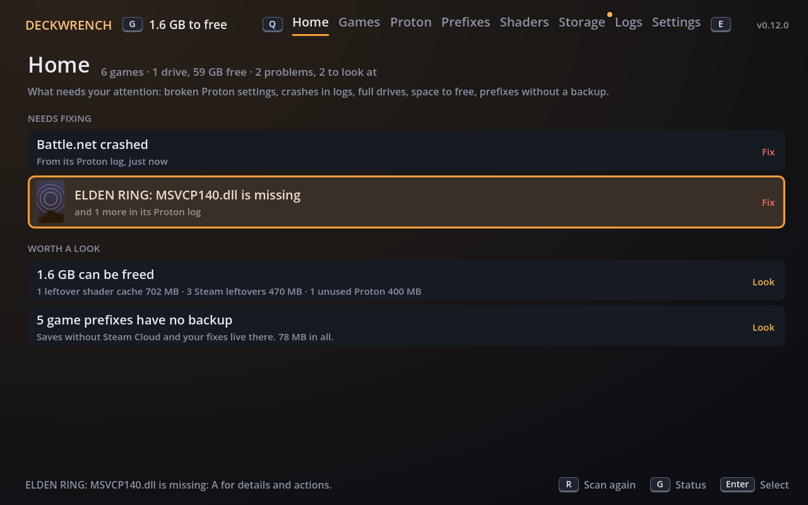
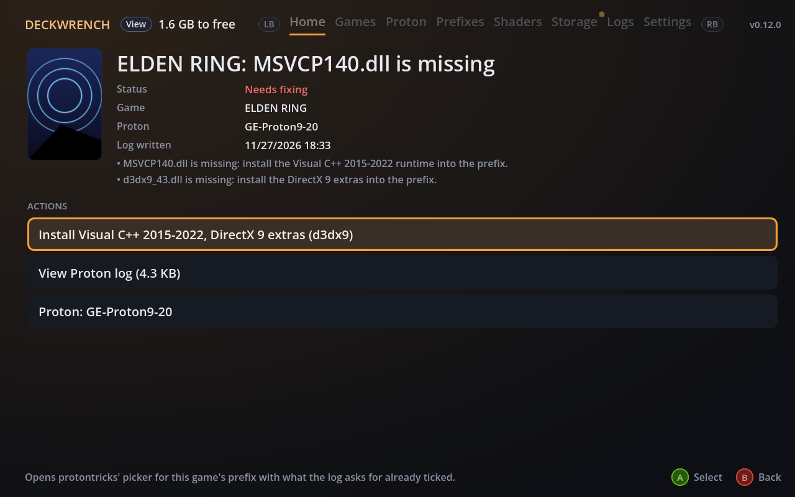
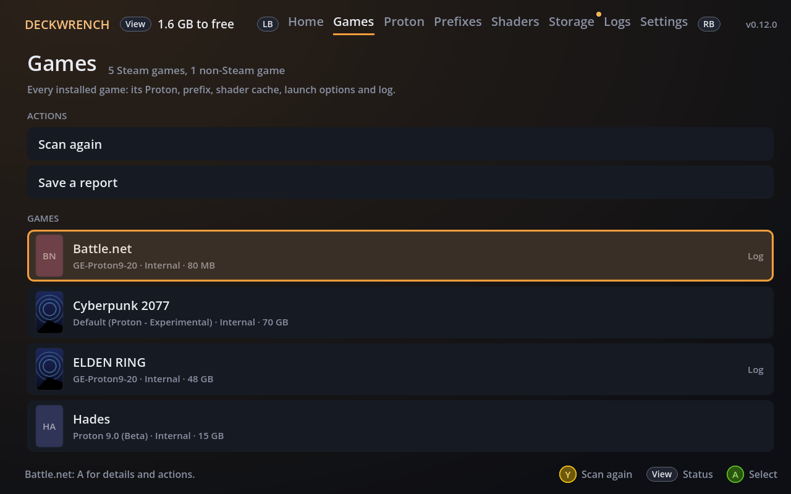
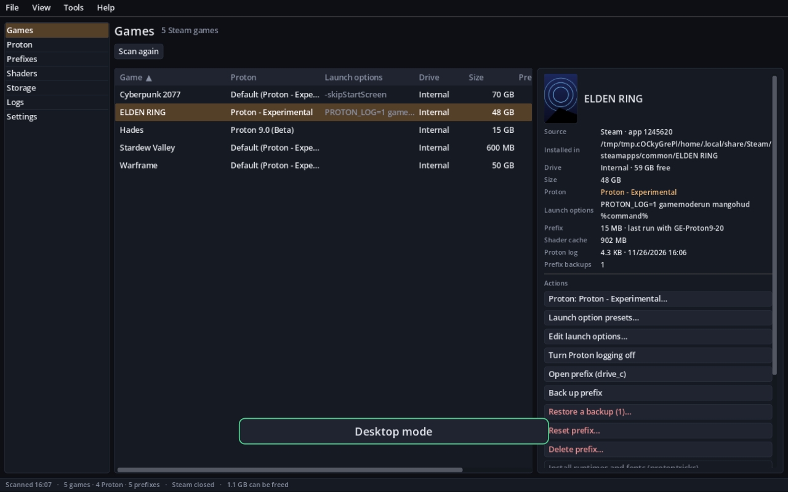
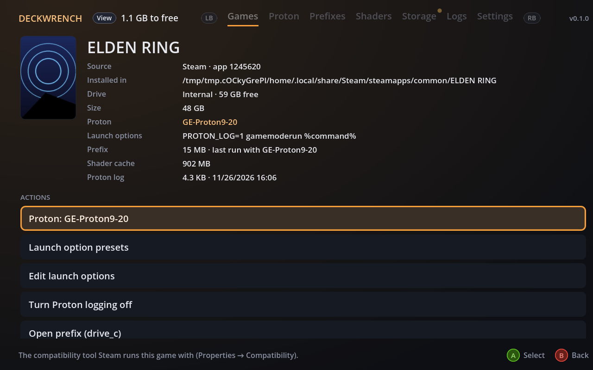
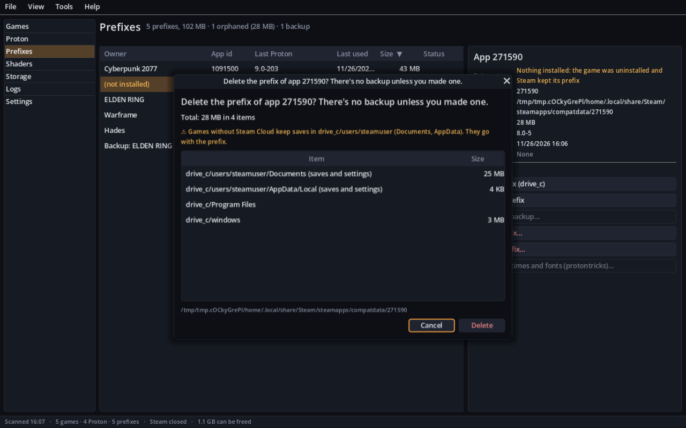
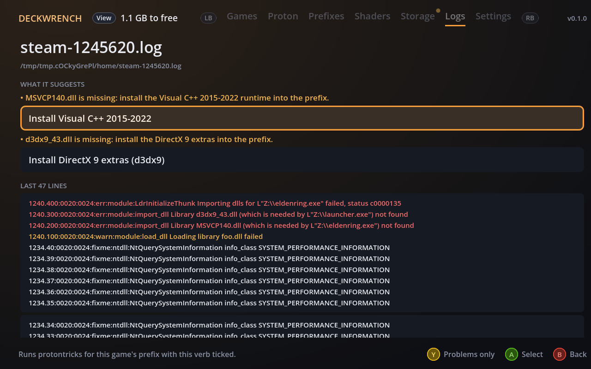
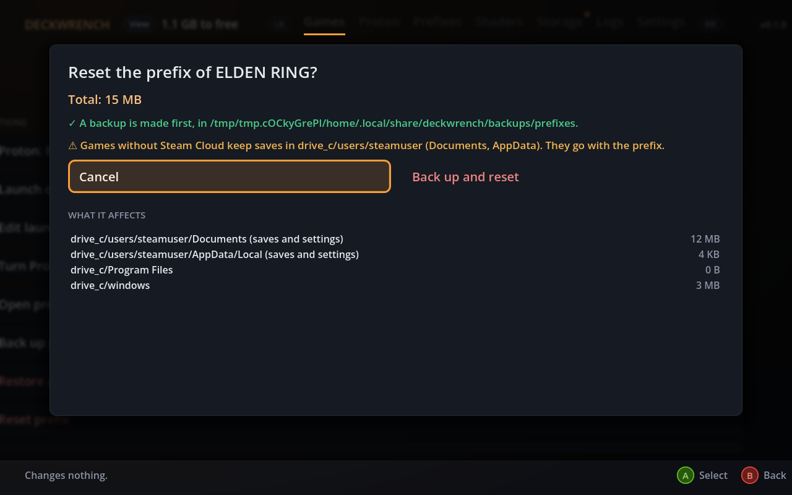

# DeckWrench

**A game won't start, the SD card is full, or a Proton update broke your save? Open DeckWrench in
Game Mode and it tells you what's wrong, and fixes it with one press.**

DeckWrench is a controller-first toolbox for **Steam Deck, SteamOS and Bazzite** (Legion Go, ROG Ally…)
that looks after everything Steam hides away: which Proton each game runs with, its Wine prefix,
shader caches, launch options, Proton logs and what's eating your storage. No terminal, no Desktop
Mode needed once it's installed. It also runs on desktop Linux and Windows.

| Home: what needs attention | One press to fix it |
| --- | --- |
|  |  |

### Install in one line

In Desktop Mode, open Konsole and paste:

```sh
curl -fsSL https://raw.githubusercontent.com/TheRoben-Dev/DeckWrench/main/tools/release/get.sh | bash -s -- --restart-steam
```

Or download **Install-DeckWrench.desktop** from the [latest release](https://github.com/TheRoben-Dev/DeckWrench/releases/latest)
and double-click it. Either way the download is checked against `SHA256SUMS`, DeckWrench goes to
`~/Applications/DeckWrench`, and it's added to Steam with its own art, so it opens from Game Mode
(Library → Non-Steam). Updates install from inside the app, with a rollback.

### What it does for you

- **Tells you what's wrong.** Home checks every game after each scan: a Proton version that was
  removed, crashes and missing DLLs in Proton logs (with the runtime that fixes them already ticked),
  drives that are nearly full, space you can free, and prefixes with no backup.
- **Frees space safely.** Leftovers of uninstalled games (prefixes, shader caches, downloads, Workshop
  items), Proton versions nothing uses, old logs. A per-drive planner moves your biggest games off the
  SD card or internal storage. You always see the size and contents before anything goes.
- **Makes Proton easy.** Download GE-Proton, switch many games to it at once, set the default, and
  run protontricks (Visual C++, .NET, DirectX extras, fonts) with a gamepad.
- **Protects your prefixes.** Back up and restore any game's prefix (saves without Steam Cloud live
  there). Resets and uninstalls back up first.
- **Works the same with a mouse.** A separate desktop layout with menus, sortable tables and
  shortcuts has every feature the controller layout has.

| Controller mode | Desktop mode |
| --- | --- |
|  |  |
|  |  |
|  |  |

## Features

| Area | What you can do |
| --- | --- |
| **Home** | A checkup after every scan, worst first: games set to a Proton that isn't installed, crashes and missing DLLs in Proton logs (with a one-press fix), drives that are nearly full, space that can be freed, prefixes with no backup, and Steam changes waiting for a restart. Also `deckwrench checkup`. |
| **Proton** | Every installed Proton (Valve, Experimental, Hotfix), GE-Proton and system build, with size and which games use it. Set a game's compatibility tool, switch several games to one version at once ("Use for games"), or set the global default. Download GE-Proton from GitHub (SHA-512 checked) and remove custom builds. |
| **Non-Steam games** | Shortcuts you added to Steam (Battle.net, emulators…) appear under Games with their Proton, prefix, shader cache, log and launch options (written to `shortcuts.vdf`). |
| **Prefixes** | Open, back up (`.tar.gz`), restore, reset (always backs up first) or delete a game's `compatdata` prefix. Run curated protontricks verbs (Visual C++, .NET, DirectX extras, fonts, Windows version), your own verbs from `tricks.json`, or type any other winetricks verb. Back up every prefix in one go, and keep only the newest backup (or few) of each. Orphaned prefixes of uninstalled games are flagged. Heroic and Lutris prefixes are listed too. |
| **Shader cache** | Size per game, clear one, clear all orphans or clear everything. |
| **Notes** | Your own note on any game ("GE-Proton9-20 fixes the cutscenes"), shown first on its page and kept in `notes.json` in the config folder. Steam games link to their ProtonDB reports (in Steam's browser in Game Mode). |
| **Report** | "Save a report" (View / Select, or `deckwrench report`) writes your system, drives, Proton versions, every game's Proton, launch options and prefix, recent Proton log errors and cleanup totals to a Markdown file to share when asking for help. Your home folder shows as `~`. |
| **Storage** | Per-drive breakdown (games, prefixes, shader caches, Proton versions, backups, everything else). Move a game between internal storage and the SD card (through Steam's own mover while Steam runs, or DeckWrench's own copy-verify-swap when it's closed). A cleanup list with what each item frees (orphaned prefixes and shader caches, unused Proton, logs, old backups, and Steam's leftover downloads, update scratch and Workshop items of uninstalled games), and a per-drive planner ("Free space on SD card") that combines that drive's cleanup with moving its biggest games to a drive that has room, showing the total before anything happens. |
| **Launch options** | View and edit per-game launch options, or toggle presets: GameMode, MangoHud, `PROTON_LOG`, WineD3D, esync/fsync/NTSync, Wayland, NVAPI, DXVK HUD/async/frame caps, VKD3D DXR and feature level, DX11/DX12 switches… |
| **Logs** | Proton log viewer (`steam-<appid>.log`): newest lines first, errors red and warnings amber, a problems-only filter, and plain-language hints with a one-press fix (`MSVCP140.dll` missing → install Visual C++ 2015-2022). |

**Safety rules:** every destructive action first shows what it removes (size and contents) and needs
an explicit confirmation, with Cancel focused. Resets make a backup first. Steam config files get a
`.deckwrench-bak` copy before every write. While Steam is running it would overwrite its own config on
exit, so changes to compatibility tools and launch options are queued and applied by restarting Steam
for you (or the next time Steam is closed).

## Two separate UI modes

- **Controller mode** (default on a Deck / in Game Mode): full screen, big rows, no cursor.
  A selects, B goes back, LB / RB switch tabs, Y scans again, View opens Status (scan state, waiting
  Steam changes). Text fields open Steam's on-screen keyboard. Touch and mouse work everywhere.
- **Desktop mode**: a classic utility window with a menu bar, a sidebar, sortable tables, a detail pane,
  right-click menus, dialogs and keyboard shortcuts (F5 scan, Ctrl+1…7 sections, Ctrl+, settings).

Both modes are rendered from the same section and action catalog, so **every feature exists in both**.
This is a permanent rule, checked by the UI smoke test (it compares the action list for the same game
in both modes).

Switch in Settings → Layout, or View → Switch to controller mode.

## Install

### SteamOS / Bazzite / Linux

The one-line install at the top is the easy way. To do it by hand, download `DeckWrench-linux-x86_64.tar.gz` from the [latest release](https://github.com/TheRoben-Dev/DeckWrench/releases/latest), then in Desktop Mode:

```sh
tar xzf DeckWrench-linux-x86_64.tar.gz
cd DeckWrench && ./install.sh            # or ./install.sh --restart-steam to add the Steam shortcut now
```

It installs to `~/Applications/DeckWrench`, adds a menu entry, and adds a Steam shortcut with
DeckWrench's own art so it opens from Game Mode. Updates are installed from inside the app
(Settings → Updates), with a rollback to the previous version.

protontricks (native or the Flatpak `com.github.Matoking.protontricks`) is needed for the runtime and
font installs; everything else has no dependencies.

Your own protontricks verbs go in `~/.config/deckwrench/tricks.json` and show up under "Your verbs"
(an entry with a built-in id replaces it):

```json
{ "verbs": [ { "id": "mfc42", "label": "MFC 4.2", "help": "An old launcher needs it." } ] }
```

Only winetricks verbs are passed to protontricks, never options: lowercase letters, digits and
`_ . + = -`, not starting with `-`.

### Windows

Download `DeckWrench-windows-x86_64.zip`, unzip, and run **Install DeckWrench.cmd**. Proton, prefix
and log tools are Linux-only and say so; Steam libraries, storage, launch options and the rest work.

## Command line

`deckwrench` (Linux) / `deckwrench-cli.exe` (Windows) prints what the app shows and runs the helper
that applies queued Steam changes:

```
deckwrench checkup          # exit code 1 when something needs fixing
deckwrench games | proton | prefixes [--orphans] | shadercache | storage | logs | pending
deckwrench apply-pending [--wait] [--restart-steam]
deckwrench steam-add [--restart]
```

## Building

Requirements: .NET 8 SDK and the Godot 4.7.2 **.NET** editor.

```sh
dotnet build DeckWrench.sln            # Core, Host, CLI, tests (warnings are errors)
dotnet test DeckWrench.sln
dotnet build src/DeckWrench.App        # the Godot project
godot --path src/DeckWrench.App        # run it
tools/smoke/run-ui-smoke.sh <godot> out/   # headless UI smoke test with screenshots (needs xvfb-run)
```

Try the CLI or the app against a fake Steam install without a Deck:

```sh
HOME=/tmp/fakehome tools/smoke/fake-steam.sh /tmp/fakehome /tmp/fakesd
HOME=/tmp/fakehome dotnet run --project src/DeckWrench.Cli -- storage
```

### Layout

```
src/DeckWrench.Core   Steam/Heroic/Lutris detection, VDF read/write, Proton, prefixes, shader caches,
                      storage, launch options, logs. No Godot.
src/DeckWrench.Host   App host: settings, scan state, the action catalog, pending Steam changes, updater.
src/DeckWrench.Cli    The `deckwrench` command.
src/DeckWrench.App    Godot UI: Scripts/Sections (shared), Controller/, Desktop/, Screens/, Ui/.
tests/                xUnit tests (incl. a full scan of the fake Steam install).
tools/                Smoke test, release packaging, installers, Steam art generator.
data/                 Curated protontricks verbs, launch presets, Steam art.
```

CI builds and tests on Linux and Windows, runs the UI smoke test from source and from the exported
build (screenshots are uploaded as an artifact), exports Linux and Windows builds, tests the Windows
installer, and publishes a release when the version in `Directory.Build.props` changes on `main`.

## Plan

See [docs/plan.md](docs/plan.md) for the phases.

## Credits

Visual style, themes, sounds, navigation and the overall code structure come from
[Luma Modman](https://github.com/TheRoben-Dev/Luma-Modman) and [Scanline](https://github.com/TheRoben-Dev/Scanline).
DeckWrench is not affiliated with Valve. GE-Proton is by GloriousEggroll.
